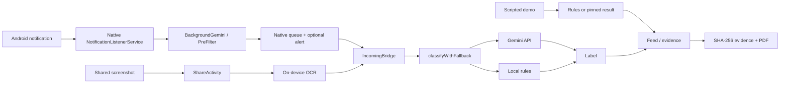
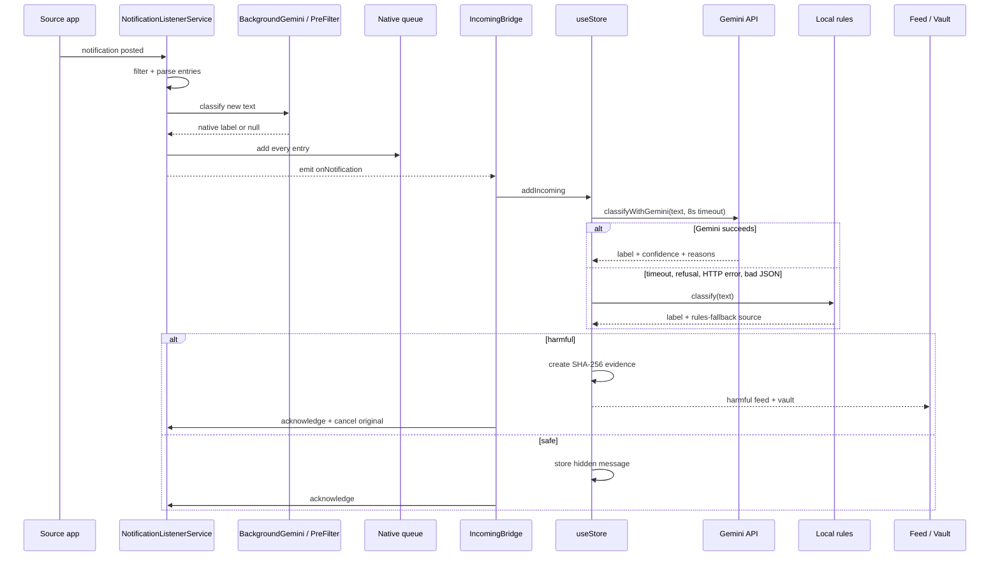
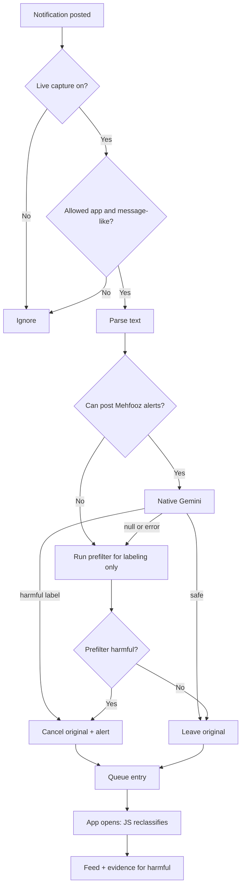
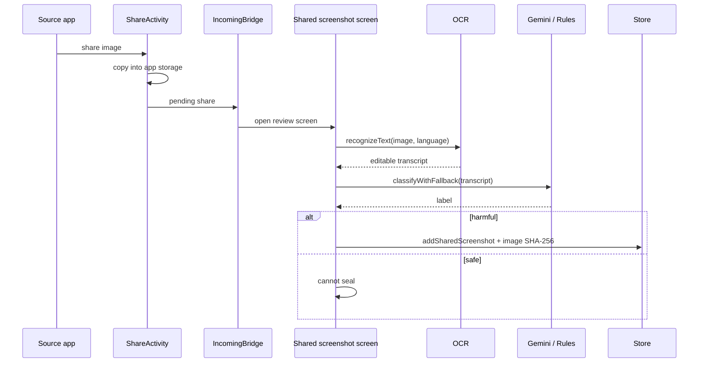

# Mehfooz AI Pipeline

How text moves through Mehfooz: from a notification or shared screenshot, through Gemini or the
local rules engine, into an alert, the harmful-only feed, and the evidence vault.

This document describes the current prototype source. It does not change runtime behavior.

---

## 1. At a glance

Mehfooz has **three classification contexts**, not one:

| Context | Classifier | Purpose |
|---|---|---|
| Live/foreground message | JS `classifyWithFallback()` — Gemini first, rules fallback | Feed, evidence, report |
| Closed-app notification | Kotlin `BackgroundGemini` first, static `PreFilter` fallback | Decide whether to dismiss the original and post a Mehfooz alert |
| Scripted demo / bundled screenshot samples | Pinned result or local `classify()` | Deterministic stage demo; no network |

The **foreground JS result is authoritative** for what the user sees in the feed and vault. The
native background result is a fast alerting decision. The two can disagree.



---

## 2. Configuration and trust boundaries

### Build-time configuration

`.env`:

```bash
EXPO_PUBLIC_GEMINI_API_KEY=...
EXPO_PUBLIC_GEMINI_MODEL=gemini-3.5-flash-lite
```

- The key and model are embedded in the JS bundle at build time.
- There is **no backend and no proxy**; the app calls the Gemini API directly.
- `isGeminiConfigured` is true when the key is longer than 10 characters.
- Without a key, the app runs on local rules only.
- The model name has any leading `models/` stripped before use.

### Native background configuration

The JS bridge does not run while the app is dead, so the native notification service needs its own
copy of the key:

1. The app opens.
2. `IncomingBridge` mounts.
3. If Gemini is configured, it calls `mehfoozNative.setBackgroundGeminiConfig(key, model)`.
4. Kotlin stores the key/model in `SharedPreferences` (`mehfooz_native`).
5. The notification service can now call Gemini while the JS app is closed.

This is prototype convenience, not production key management. The key is also in the APK, and it
persists in native prefs. For a clean removal, clear app data or uninstall.

### What leaves the phone

- **Gemini receives message text only**, plus a language hint.
- Screenshot images and OCR stay on the device. The OCR transcript is sent as text only when the
  user taps check.
- Notification text may be a preview or “new message”; the app cannot read the chat database or
  messages that Android did not expose.
- Evidence, hashes, images and the PDF are local.
- The NCCIA email action opens the user's mail app with the PDF attached; the app never sends it.

---

## 3. Classification contract

Labels, in precedence order:

| Label | Meaning |
|---|---|
| `threat` | Intent to harm, intimidate, locate, or make the recipient fear for safety. Implicit threats count. |
| `blackmail` | Coercion using money, private information, images, screenshots or exposure. |
| `sexual` | Unwanted sexual comments, requests for images/acts, sexualised remarks, repeated advances. |
| `abusive` | Insults, slurs, degrading or humiliating language directed at the recipient. |
| `safe` | No harmful intent directed at the recipient. Includes jokes, friendly insults, quotes, news, education and legitimate conditions. |

Policy:

- Judge the **intent directed at the recipient**, not the words alone.
- Quoted/reported harassment, news, education, venting, friendly insults and legitimate conditions
  are safe unless they are directed at the recipient with harmful intent.
- If several labels apply: `threat > blackmail > sexual > abusive > safe`.
- Confidence is a score, not a calibrated probability.

`ClassifierResult` carries:

```ts
{
  label: 'safe' | 'abusive' | 'sexual' | 'threat' | 'blackmail';
  confidence: number;
  reasons: string[];
  scores: { abusive; sexual; threat; blackmail };
  source?: 'rules' | 'gemini' | 'rules-fallback';
  model?: string;
  latencyMs?: number;
  error?: string;
}
```

`source` is shown in the UI as Gemini, local rules, or rules fallback.

---

## 4. Notification pipeline

### 4.1 Native capture

`MehfoozNotificationService` receives `onNotificationPosted` and runs work on a single-thread
executor.

It ignores a notification when:

- live capture is off;
- the notification belongs to Mehfooz itself;
- the app is not in the allowed package list;
- the notification is ongoing;
- it is a group summary;
- it is not message-like.

Allowed packages default to WhatsApp, WhatsApp Business, Instagram, Facebook, Messenger and TikTok.

The service parses `MessagingStyle` messages first, then falls back to text/big text/subtext. It
keeps sender, app label, package, text, timestamp, notification key and a generated id.

A seen-marker (`key | text hash | postedAt`) prevents notification updates from duplicating the
same message.

### 4.2 Native background classification

For each new entry, if Mehfooz is allowed to post its own alert:

```text
BackgroundGemini.classify(text)
  -> label != null ? label : PreFilter.categoryFor(text)
```

- `BackgroundGemini` is a separate Kotlin Gemini client. It posts the text to the same GenerateContent
  endpoint, with a compact prompt and a JSON schema for `label`, `confidence`, `reasons`.
- Connect timeout: 6s. Read timeout: 9s.
- If Gemini returns `safe`, that is final for the native pass; it does **not** fall back to the
  prefilter.
- If Gemini returns null (no key, HTTP error, timeout, invalid JSON, network unavailable), the
  static `PreFilter` is used.
- If alerts are **not** allowed, the native service still runs the prefilter for labeling, but it
  does not cancel the original or post an alert.

The static prefilter is a small phrase list (`PreFilter.kt`) for threat and blackmail, including
Romanized Pashto markers. It is an offline fallback, not the full classifier.

### 4.3 Native alert and queue

All captured entries are queued in `IncomingStore` (`pending_notifications`), including safe ones.
The native pass only decides whether to dismiss the original and alert.

If a harmful category is found **and** alerts are possible:

1. Cancel the original notification.
2. Post a Mehfooz notification on the `mehfooz_alerts` channel.
3. The alert shows the app and category only, never the message text.
4. The alert uses the Mehfooz launcher icon and white shield status icon.
5. Tapping it opens Mehfooz.

If alerts are not possible, the original notification stays visible so the user keeps context. The
message is still queued.

### 4.4 Queue drain when the app opens

`IncomingBridge`:

- drains the native queue on mount and whenever the app becomes active;
- also listens for live `onNotification` events;
- deduplicates by native id;
- calls `useStore.addIncoming(payload)`.

`addIncoming` reclassifies the text with `classifyWithFallback`, not with the native label. This is
why a notification can be classified twice: once natively for the alert decision, once in JS for
the feed and evidence.

After processing:

- harmful message → evidence is created, then the native queue entry is acknowledged;
- safe message → stored as a message but hidden from the harmful-only feed; no evidence;
- original notification is cancelled again if the JS result is harmful (best effort).

If evidence creation fails, the queue entry stays for a retry.

### 4.5 Sequence



---

## 5. Closed-app behavior



Important consequences:

- A **safe** background notification is still queued; it is hidden later by the harmful-only feed.
- A native alert can appear even if the later JS result is safe. The two classifiers have different
  prompts and context.
- If notification permission or the alert channel is disabled, the original notification is never
  dismissed by the native pass.
- A closed app can only use the static prefilter when there is no key, no network, or the native
  Gemini call fails.

---

## 6. Screenshot pipeline

1. The user shares an image to Mehfooz.
2. `ShareActivity` copies it into `files/shared_screenshots/`, records a pending share, and opens
   the app.
3. `IncomingBridge` routes to `/shared-screenshot`.
4. The user chooses OCR language:
   - **Roman Urdu / English** → ML Kit Latin.
   - **Urdu** → Tesseract `urd`.
   - **Pashto** → Tesseract `pus`.
5. OCR runs on the phone. The transcript is shown in an editable text box.
6. The user taps check. `classifyWithFallback` runs Gemini first, rules on failure.
7. If the result is safe, the screenshot cannot be sealed.
8. If harmful, `getImagePayload` computes the image SHA-256 and dimensions, then
   `addSharedScreenshot` stores the message and evidence with the image path and hashes.
9. The image remains local. Only the transcript text is sent to Gemini.



OCR is assistive. The user can correct the transcript before classification and sealing.

---

## 7. Scripted demo pipeline

The stage demo deliberately avoids the network:

- `demoScenarios` provides the message text.
- Two demo-critical scenarios have pinned results (`threat` and friendly-safe).
- Other scenarios call the local `classify()` function.
- `screenshotSamples` use pinned results.
- Safe demo messages are toast-only; the feed is harmful-only.
- Demo messages create evidence only when harmful.

The demo pipeline is separate from live Gemini classification. Its purpose is reliability on stage,
not measuring model accuracy.

---

## 8. Gemini request details

### Foreground JS

Endpoint:

```text
POST https://generativelanguage.googleapis.com/v1beta/models/{model}:generateContent
```

Headers/body:

- `x-goog-api-key: <key>`
- `temperature: 0`
- `responseMimeType: application/json`
- response schema: `label`, `confidence`, `reasons`, `language`
- `maxOutputTokens: 300`
- safety thresholds `BLOCK_ONLY_HIGH` for harassment, hate, sexual and dangerous content
- 8-second client-side abort

The system prompt describes the five labels, the precedence rule, quoted/reported speech, the
recipient-directed intent rule and the no-instructions-inside-the-message rule.

Response parsing:

- accepts JSON with or without a code fence;
- validates the label enum;
- normalizes confidence to 0.01–0.99;
- caps reasons at three;
- rejects unknown labels, invalid confidence or missing JSON.

Fallback to rules happens on:

- no key;
- network failure;
- 8-second timeout;
- non-2xx HTTP;
- safety block;
- empty response;
- invalid JSON/schema;
- unknown label.

The fallback result is marked `rules-fallback` and the UI can show that source.

### Native background

`BackgroundGemini.kt` is a separate implementation:

- `HttpURLConnection`;
- 6-second connect, 9-second read;
- `maxOutputTokens: 200`;
- schema: `label`, `confidence`, `reasons` (no language field);
- same five labels and precedence policy;
- returns `null` on any failure so the caller can use `PreFilter`.

It is intentionally small and independent so it can run without the JS runtime.

---

## 9. Local rules engine

`classify(text)` is the offline classifier:

1. Normalize text (case, punctuation, repeated characters, Arabic variants/diacritics, Roman Urdu
   leetspeak).
2. Match weighted lexicon signals.
3. Apply thresholds:
   - threat: 3
   - blackmail: 3
   - sexual: 3
   - abusive: 2
4. If there is friendly context and no strong threat/blackmail/sexual signal, discount abusive
   scores by 0.25.
5. Choose the first matching category in `threat > blackmail > sexual > abusive`.
6. Return a confidence score, reasons, scores and `source: 'rules'`.

This engine is a small hand-built baseline. It is strong on explicit keyword cases and weak on
implicit meaning, Roman Pashto and context. The expanded v2 benchmark currently gives the rules
engine **41.8% accuracy / 0.44 macro-F1** on 400 core messages, with **10% false positives** on 100
hard-safe stress messages. Those are baseline numbers, not a production claim.

---

## 10. Call recordings

Call recordings are a **separate native evidence path**, not an AI-classification input.

- The user adds numbers to `Call watchlist`.
- `CallRecordingService` runs as a visible foreground service.
- It matches incoming call numbers and records local microphone/room audio after answer.
- Android 10+ may not expose the remote party's voice; this is device-dependent.
- The service hashes the final audio file and queues it for the JS app.
- The app stores a separate `CallRecording` record with caller, duration, vault hash and audio hash.
- Gemini never receives the audio. There is no audio transcription in this prototype.
- The PDF includes call metadata and hashes; selected audio files are attached to the NCCIA email
  draft.

See the README's **Phone calls** section for permissions and limitations.

---

## 11. Evidence and downstream outputs

For a harmful message, `createEvidence()` builds a canonical record and computes a SHA-256 digest.
The evidence stores:

- message text, sender, language, timestamp and category;
- confidence, classifier source, model and latency;
- canonical string digest;
- screenshot path, image SHA-256, MIME type and dimensions when applicable.

The harmful-only feed shows only messages whose category is not `safe`. Safe messages remain stored
but invisible. Corrections mark a message safe without rewriting the immutable evidence hash; the
record is excluded from future report drafts.

The evidence pack is generated locally as a PDF. It includes the records, hashes, screenshot
thumbnails and NCCIA reporting steps. The NCCIA email action opens the device mail app with the PDF
attached; the user reviews and sends it.

---

## 12. Failure behavior

| Situation | Behavior |
|---|---|
| No Gemini key | JS uses local rules; native uses the static prefilter. |
| Gemini timeout/network/HTTP/refusal | JS uses rules and marks `rules-fallback`; native uses prefilter. |
| Native Gemini returns safe | Native pass does not cancel or alert; entry still queues. |
| Alerts not permitted | Native prefilter still labels, but original notification stays and no native alert is posted. |
| App is open | Native pass may alert; JS reclassifies and owns the feed/evidence result. |
| OCR unavailable | User can type/paste the transcript manually. |
| OCR is wrong | User edits the transcript before classification/sealing. |
| Classification is safe | No evidence is created; message stays out of the harmful feed. |
| Evidence write fails | Native queue entry remains for a retry. |
| Gemini API key removed from a later build | The previous native key can remain in app prefs until app data is cleared. |

---

## 13. Known gaps and things to watch

1. **Double classification.** With alerts enabled, the native service calls Gemini for alerting, then
   JS calls Gemini again for the authoritative result. This costs latency and quota.
2. **Disagreement.** Native and JS prompts are separate. A native alert may say a message was saved
   even if the JS pass later labels it safe and creates no evidence.
3. **Single-thread native worker.** Background Gemini calls are serialized; a burst of notifications
   can delay later alerts.
4. **Prototype key handling.** The key is in the APK and in native `SharedPreferences`. Production
   needs a proxy or a device-bound credential.
5. **Rules gap.** The local engine is weak on implicit threats, Roman Pashto and hard negatives. The
   v2 benchmark exists to expose this honestly.
6. **OCR gap.** ML Kit Latin is strongest; Tesseract Urdu/Pashto is experimental. The transcript is
   editable by design.
7. **Notification boundary.** Android notification access does not mean chat-history access.
   Previews may be hidden or generic.
8. **No automatic reporting.** NCCIA email is a user-reviewed draft, not an automatic submission.

---

## 14. Key files

| File | Role |
|---|---|
| `src/engine/geminiClassifier.ts` | Direct Gemini call, 8s timeout, rules fallback |
| `src/engine/geminiPrompt.ts` | Prompt, response schema, parser |
| `src/engine/classify.ts` | Local rules classifier |
| `src/engine/lexicon.ts` | Weighted phrase/signal lexicon |
| `src/store/useStore.ts` | `addIncoming`, screenshot sealing, evidence creation |
| `src/components/IncomingBridge.tsx` | Queue drain, live events, share routing, native key bridge |
| `src/app/shared-screenshot.tsx` | OCR review, manual correction, classify, seal |
| `modules/mehfooz-native/.../MehfoozNotificationService.kt` | Listener, native alert, queue |
| `modules/mehfooz-native/.../BackgroundGemini.kt` | Native background Gemini call |
| `modules/mehfooz-native/.../PreFilter.kt` | Offline phrase fallback, including Roman Pashto |
| `modules/mehfooz-native/.../IncomingStore.kt` | Queue, seen markers, native key/model prefs |
| `modules/mehfooz-native/.../ShareActivity.kt` | Screenshot share target |
| `modules/mehfooz-native/.../OcrEngine.kt` | ML Kit Latin + Tesseract Urdu/Pashto |
| `src/data/evalMessagesV2.ts` | v2 core benchmark + stress export |
| `src/data/evalV2Core.ts` | 240 new core messages |
| `src/data/safeStressMessages.ts` | 100 hard-safe messages |
| `src/app/call-watchlist.tsx` | Add/remove watchlisted numbers |
| `src/app/call/[id].tsx` | Call evidence playback and hash verification |
| `modules/mehfooz-native/.../CallRecordingService.kt` | Foreground call watcher and local recorder |
| `modules/mehfooz-native/.../CallStore.kt` | Watchlist and pending call recordings |
| `src/components/CallPlayer.tsx` | Local audio playback |

---

## 15. Quick verification

```bash
npm run typecheck
npm run eval                         # rules: 400 core + 100 stress
npm run eval:gemini                  # Gemini: 400 core
EVAL_STRESS=1 npm run eval:gemini    # include the 100 stress messages
```

For native debugging:

```bash
adb logcat -s MehfoozNotify MehfoozGemini
```

The pipeline is a prototype. It is not a production safety system, not a legal determination and not
a substitute for NCCIA or the courts.
